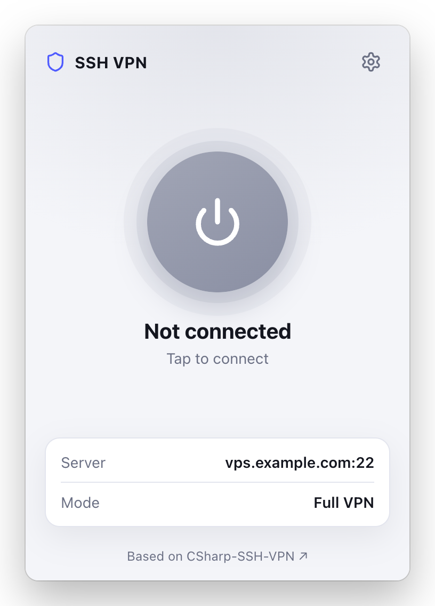
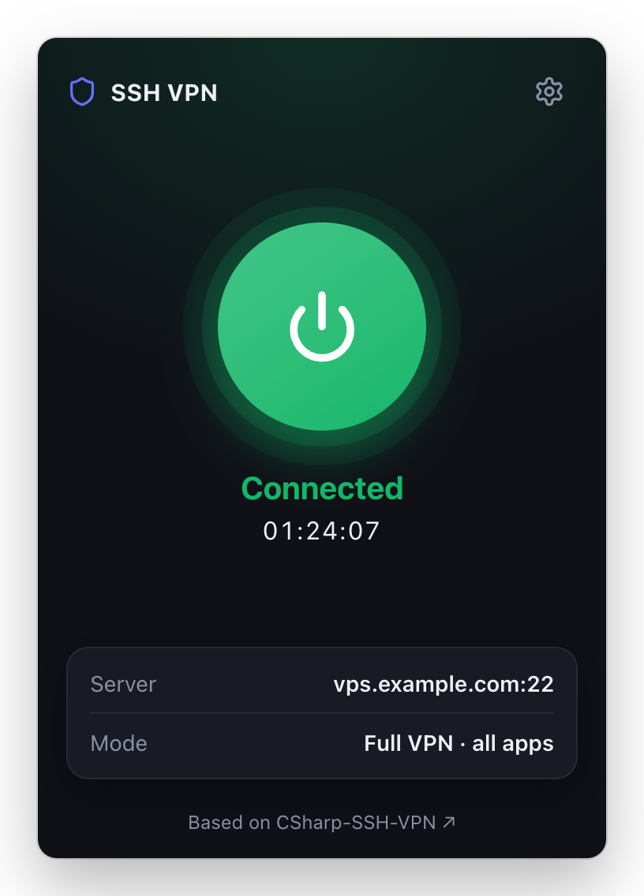
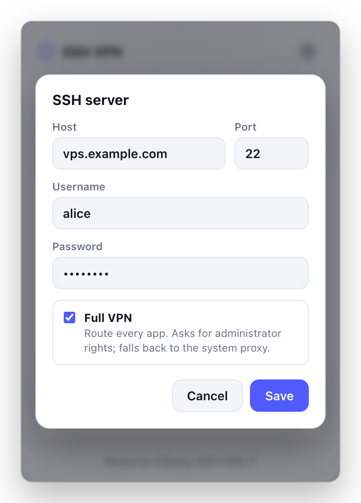
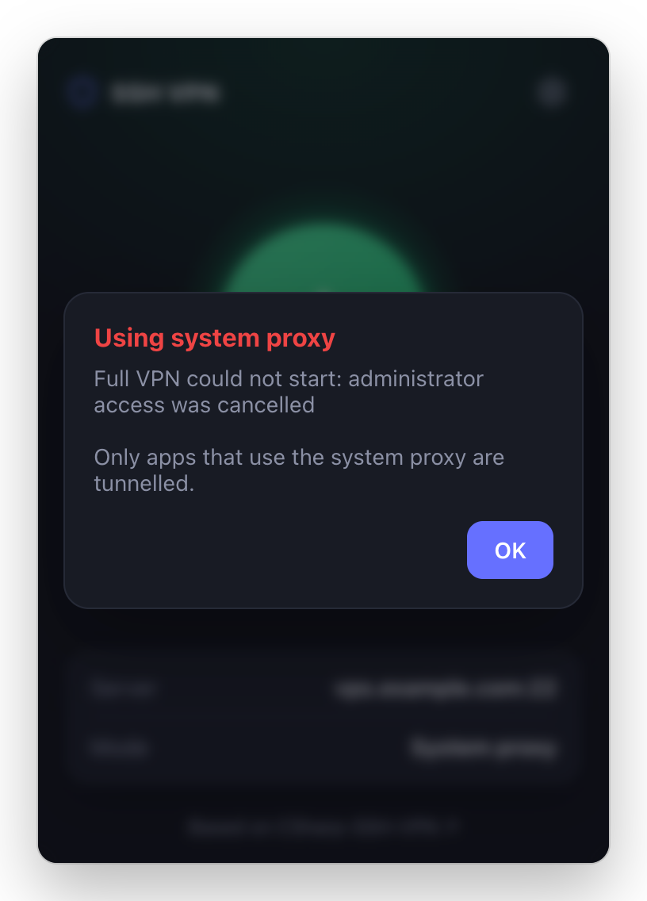
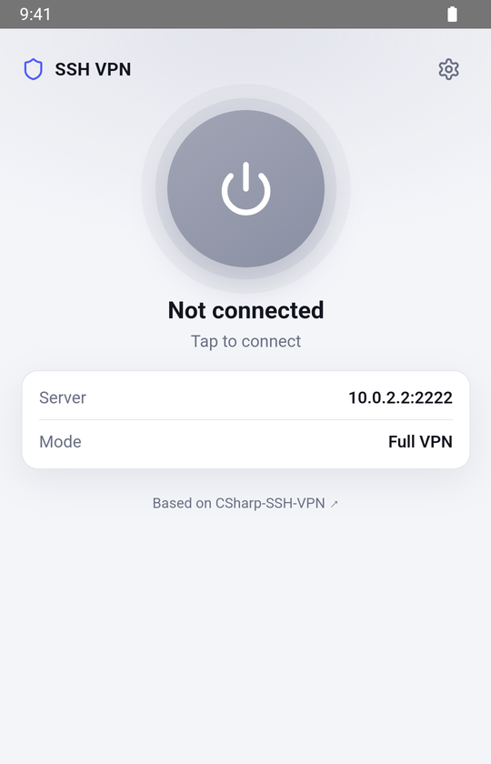
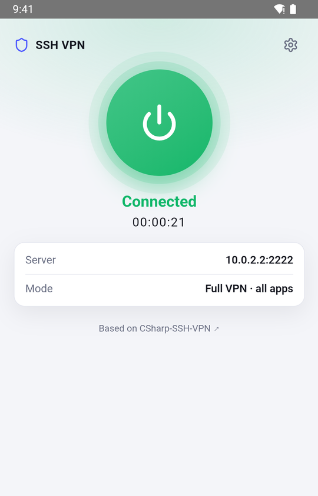
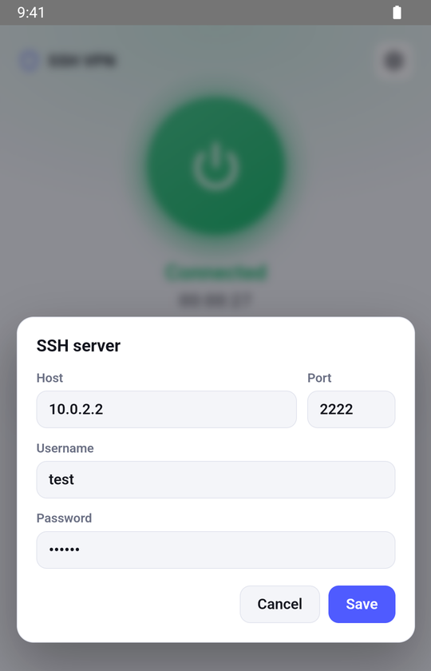

# ssh-vpn (Rust + Dioxus)

Port of [omidmousavi/CSharp-SSH-VPN](https://github.com/omidmousavi/CSharp-SSH-VPN).
It uses an SSH server as a VPN. The app opens an SSH session and starts a SOCKS4/4a/5 server on `127.0.0.1:9000` that sends traffic through the server (`ssh -D` style). It then routes the whole device through it.

**Desktop** (Windows, macOS, Linux)

<table>
  <tr>
    <td align="center"><br><sub>Ready to connect</sub></td>
    <td align="center"><br><sub>Connected, all apps tunnelled</sub></td>
    <td align="center"><br><sub>Server settings</sub></td>
    <td align="center"><br><sub>Fallback when admin rights are refused</sub></td>
  </tr>
</table>

**Android**

<table>
  <tr>
    <td align="center"><br><sub>Ready to connect</sub></td>
    <td align="center"><br><sub>System-wide VPN</sub></td>
    <td align="center"><br><sub>Server settings</sub></td>
  </tr>
</table>

## How traffic is routed

**Full VPN (default).** A TUN interface takes the default route, and [tun2proxy](https://github.com/tun2proxy/tun2proxy) turns every connection into a request to the SOCKS server. All apps are tunnelled, and DNS is resolved on the SSH server, so there are no DNS leaks (on Windows, which asks every adapter's DNS servers at once, a catch-all name resolution policy rule sends all lookups into the tunnel while it is up). On desktop this needs administrator rights. A copy of the app starts as a small helper behind the OS prompt (UAC on Windows, the password dialog on macOS, `pkexec` on Linux); the window itself never runs as admin. The helper restores routes and DNS when you disconnect, or when the app quits or crashes.

**System proxy (fallback).** If the prompt is cancelled or the TUN interface cannot be created, the app sets the OS proxy instead and tells you so. Only apps that honour the system proxy are tunnelled. You can also make this the default by unticking *Full VPN* in settings.

| Platform | Full VPN | System proxy fallback |
|----------|----------|-----------------------|
| Windows  | Wintun adapter (driver embedded in the .exe) | `HKCU\...\Internet Settings` + WinINet refresh |
| macOS    | `utun` interface | `networksetup -setsocksfirewallproxy` on every enabled service |
| Linux    | `tun` interface (needs polkit / `pkexec`) | GNOME `gsettings org.gnome.system.proxy` |
| Android  | `VpnService` + tun2proxy (always) | n/a |

Limits: plain SSH carries TCP only, so UDP other than DNS (QUIC, VoIP, games) does not go through; browsers fall back to TCP. On desktop, only IPv4 is routed into the tunnel; hostnames resolve to IPv4 through the tunnel's DNS, so only connections to literal IPv6 addresses bypass it.

## Download

Every push builds all platforms in GitHub Actions (`.github/workflows/build.yml`); the files are under the run's **Artifacts**.
Pushing a `v*` tag also runs the end-to-end tests and, if they pass, publishes them on a GitHub release:

| File | Platform |
|------|----------|
| `ssh-vpn-windows-x64.exe` | Windows 10/11 (needs the WebView2 runtime, included in Windows 11) |
| `ssh-vpn-macos-arm64.dmg`, `ssh-vpn-macos-x64.dmg` | macOS Apple Silicon / Intel |
| `ssh-vpn-linux-x64.tar.gz` | Linux (needs `libwebkit2gtk-4.1`) |
| `ssh-vpn-android-arm64.apk` | Android (arm64) |

The desktop binaries are not code-signed with a trusted certificate, so Windows SmartScreen and macOS Gatekeeper warn the first time you open them. On Windows choose *More info → Run anyway*. On macOS, open the app once, then go to *System Settings → Privacy & Security* and click *Open Anyway* (or run `xattr -dr com.apple.quarantine /Applications/SshVpn.app`).

To ship a macOS build that opens without a warning, add a Developer ID certificate and notarization credentials as repository secrets: `MACOS_CERTIFICATE_P12_BASE64` (`base64 -i cert.p12`), `MACOS_CERTIFICATE_PASSWORD`, `APPLE_ID`, `APPLE_TEAM_ID` and `APPLE_APP_PASSWORD` (an app-specific password). CI then signs with the hardened runtime, notarizes and staples the DMG.

The APK is a minified release build. To sign it with your own key (needed for updates to install over an earlier version), add these repository secrets: `ANDROID_KEYSTORE_BASE64` (`base64 -i release.jks`), `ANDROID_KEYSTORE_PASSWORD`, `ANDROID_KEY_ALIAS` and `ANDROID_KEY_PASSWORD`. Without them CI signs each build with a throwaway key.

## Build locally

```sh
cargo run --release                                    # desktop, current OS
cargo xwin build --release --target x86_64-pc-windows-msvc   # Windows .exe from macOS/Linux
dx bundle --desktop --release --package-types macos --out-dir bundle \
  && scripts/macos-dmg.sh bundle/SshVpn.app ssh-vpn.dmg  # macOS .dmg
dx bundle --android --release --target aarch64-linux-android \
  --features mobile --no-default-features              # Android .aab (SDK + NDK + JDK 17);
                                                       # see the workflow for turning it into a signed .apk
```

With `cargo xwin`, ipstack's build script runs a nested `cargo metadata`, which fails on the Windows-only rustflags xwin exports. Put a `cargo` wrapper first in `PATH` that runs `unset CARGO_ENCODED_RUSTFLAGS` when its first argument is `metadata`, then calls the real cargo. Native Windows builds (and CI) are not affected.

End-to-end tests live in `e2e/` (see `e2e/README.md`). Pushing a `v*` tag runs them on Windows, macOS, Linux and an Android emulator, full VPN included, and the release is only published if they all pass. They can also be started by hand from the Actions tab (`E2E`).

Settings are saved in `settings.json` in the OS config dir (`~/Library/Application Support/ssh-vpn`, `%APPDATA%\ssh-vpn\config`, `~/.config/ssh-vpn`). The password is stored in plain text, as in the original; on Unix the file is chmod 600.
The host key is trusted the first time you connect. If it changes later, the connection is refused.

`assets/wintun/wintun.dll` is the official [Wintun](https://www.wintun.net) 0.14.1 amd64 build (zip SHA-256 `07c25618…ef51`), redistributed under its prebuilt-binaries licence (`assets/wintun/LICENSE.txt`).
